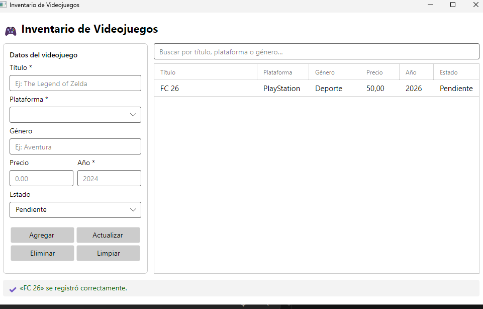
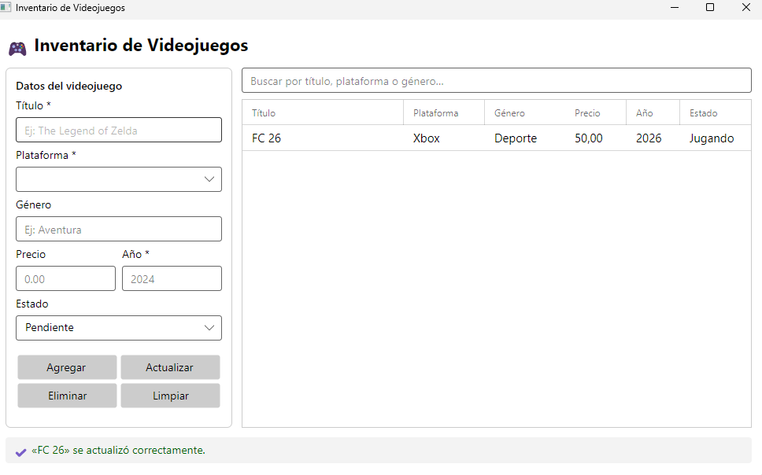
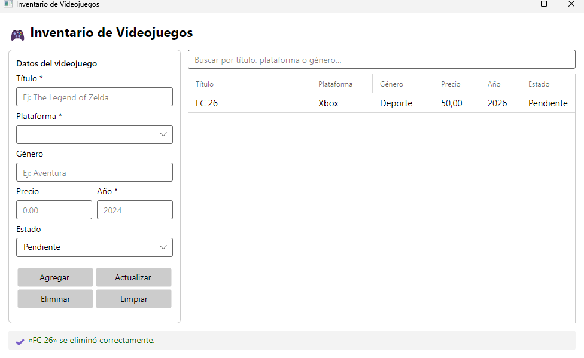
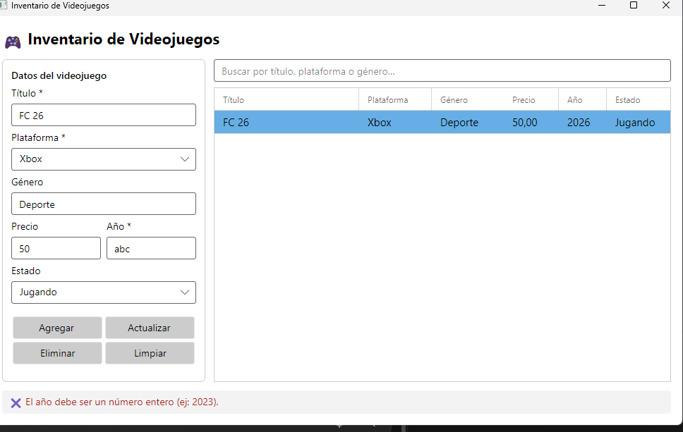

# 🎮 Inventario de Videojuegos

## 1. Información general

- **Proyecto:** Inventario de Videojuegos
- **Estudiante:** Yojaner Sanjuan
- **Asignatura:** Electiva de profundizacion
- **Descripción:** aplicación de escritorio para registrar y administrar una colección personal de videojuegos.
- **Problema que resuelve:** llevar el control de qué juegos se tienen, en qué plataforma, cuánto costaron y si ya se jugaron, sin depender de notas sueltas u hojas de cálculo.
- **Objetivo principal:** aplicar POO, Avalonia UI y ADO.NET con SQLite en una aplicación con CRUD completo y datos persistentes.

## 2. Funcionalidades

- **Agregar** un videojuego (título, plataforma, género, precio, año y estado).
- **Consultar** todos los registros en una tabla, ordenados por título.
- **Buscar** en tiempo real por título, plataforma o género.
- **Modificar** un registro: se selecciona en la tabla, se editan los datos y se pulsa *Actualizar*.
- **Eliminar** un registro, con ventana de confirmación.
- **Validaciones** con mensajes claros (título obligatorio, año y precio numéricos, rangos válidos, no duplicar título + plataforma).
- **Persistencia:** los datos se conservan al cerrar y volver a abrir la aplicación.

## 3. Tecnologías utilizadas

| Tecnología | Detalle |
|---|---|
| Lenguaje | C# 12 |
| Plataforma | .NET 8 (`net8.0`) |
| Interfaz gráfica | Avalonia UI 11.2.3 (`.axaml`) |
| Acceso a datos | ADO.NET con `Microsoft.Data.Sqlite` 8.0.11 |
| Base de datos | SQLite |
| Paquetes | `Avalonia`, `Avalonia.Desktop`, `Avalonia.Themes.Fluent`, `Avalonia.Controls.DataGrid`, `Microsoft.Data.Sqlite` |

## 4. Estructura del proyecto

```
InventarioVideojuegos/
├── Models/
│   └── Videojuego.cs            # Entidad (datos)
├── Data/
│   ├── BaseDatos.cs             # Ruta del .db, conexión y creación de la tabla
│   └── VideojuegoDAO.cs         # CRUD con ADO.NET (único lugar con SQL)
├── Services/
│   └── VideojuegoServicio.cs    # Validaciones y reglas del programa
├── Views/
│   ├── MainWindow.axaml         # Interfaz (XAML)
│   └── MainWindow.axaml.cs      # Eventos de la interfaz
├── Database/
│   └── schema.sql               # Script de la tabla (referencia)
├── evidencias/                  # Capturas de las pruebas
├── App.axaml / App.axaml.cs
├── Program.cs
├── InventarioVideojuegos.csproj
└── README.md
```

### Clases principales y responsabilidades

| Clase | Responsabilidad |
|---|---|
| `Videojuego` | Representa un juego: propiedades, constructores y métodos. |
| `BaseDatos` | Ubica el archivo SQLite, crea conexiones e inicializa la tabla. |
| `VideojuegoDAO` | Ejecuta `INSERT`, `SELECT`, `UPDATE` y `DELETE` parametrizados. |
| `VideojuegoServicio` | Valida los datos, aplica reglas (no duplicados) y devuelve un `Resultado` a la interfaz. |
| `MainWindow` | Lee los controles, llama al servicio y muestra mensajes y la lista. |

**Flujo:** `MainWindow` → `VideojuegoServicio` → `VideojuegoDAO` → SQLite. La interfaz nunca escribe SQL y el DAO nunca toca controles gráficos.

### Dónde se aplica la POO

- **Clases y objetos:** `Videojuego`, `VideojuegoDAO`, `VideojuegoServicio`, `MainWindow`.
- **Propiedades y constructores:** `Videojuego` tiene dos constructores (registro nuevo y registro leído de la BD).
- **Encapsulamiento:** `Id` solo se asigna con `private set` / `AsignarId`; los textos se normalizan (`Trim`) dentro de las propiedades.
- **Separación de responsabilidades:** interfaz, lógica y acceso a datos están en clases distintas.
- No se usó herencia ni interfaces porque, con una sola entidad, no tenían una justificación funcional.

## 5. Instalación de dependencias

1. Instalar el **SDK de .NET 8** (https://dotnet.microsoft.com/download). Verificar con `dotnet --version`.
2. Clonar el repositorio:
   ```bash
   git clone https://github.com/yojaner321/InventarioVideojuegos.git
   cd InventarioVideojuegos
   ```
3. Restaurar los paquetes NuGet declarados en el `.csproj`:
   ```bash
   dotnet restore
   ```
No se necesita ninguna otra configuración.

## 6. Ejecución del programa

Desde la carpeta que contiene `InventarioVideojuegos.csproj` (la raíz del repositorio):

```bash
dotnet restore
dotnet run
```

## 7. Base de datos

- **Qué almacena:** los videojuegos de la colección.
- **Tabla `Videojuegos`:**

| Campo | Tipo | Notas |
|---|---|---|
| `Id` | INTEGER | Clave primaria autoincremental |
| `Titulo` | TEXT | Obligatorio |
| `Plataforma` | TEXT | Obligatorio |
| `Genero` | TEXT | Opcional |
| `Precio` | REAL | ≥ 0 |
| `Anio` | INTEGER | Entre 1970 y el año actual + 2 |
| `Estado` | TEXT | Pendiente, Jugando o Completado |

- **Conexión:** `Microsoft.Data.Sqlite` con `SqliteConnection` (`BaseDatos.CrearConexion()`), siempre dentro de `using` para liberar los recursos.
- **Dónde está el CRUD:** `Data/VideojuegoDAO.cs` (`Insertar`, `Listar`, `Actualizar`, `Eliminar`), con parámetros `@nombre`.
- **Inicialización:** automática. Al abrir la aplicación, `BaseDatos.Inicializar()` crea el archivo y la tabla si no existen. No hay que ejecutar nada antes. `Database/schema.sql` contiene el mismo script como referencia.
- **Ubicación del archivo:** `videojuegos.db` en la carpeta `InventarioVideojuegos` dentro de los datos locales del usuario (`Environment.SpecialFolder.LocalApplicationData`). En Windows: `%LOCALAPPDATA%\InventarioVideojuegos\`.

## 8. Evidencias de funcionamiento

Capturas de las pruebas funcionales realizadas (carpeta `evidencias/`).

### Prueba 1 — Registro
Se completa el formulario y se pulsa *Agregar*. El videojuego «FC 26» se guarda en la base de datos y el programa muestra el mensaje de éxito.


### Prueba 2 — Consulta
La tabla muestra los registros almacenados en SQLite, cargados desde la base de datos con `VideojuegoDAO.Listar()`.



### Prueba 3 — Actualización
Se selecciona un registro de la tabla, se cambia su estado a *Jugando* y se pulsa *Actualizar*. El cambio se guarda y se refleja en la tabla.



### Prueba 4 — Eliminación
Se selecciona un registro y se pulsa *Eliminar*, confirmando en la ventana de diálogo. El programa informa que se eliminó correctamente y la tabla se actualiza.



### Prueba 5 — Validación
Se escribe `abc` en el campo Año y se pulsa *Agregar*. El programa muestra el mensaje de error «El año debe ser un número entero» sin cerrarse y no guarda nada.



## 9. Problemas encontrados y soluciones

**Problema: el proyecto no compilaba por propiedades que no existen en `Grid`.**
Al ejecutar la aplicación por primera vez, Visual Studio Code mostró la ventana «Errores de compilación» y el proyecto no se pudo compilar. En el detalle del error aparecían mensajes como `Unable to resolve suitable regular or attached property ColumnSpacing on type Avalonia.Controls.Grid` (y lo mismo con `RowSpacing`), apuntando a la línea 28 de `MainWindow.axaml`.

**Causa:** en el XAML se usaron `ColumnSpacing` y `RowSpacing` en tres elementos `Grid` (el formulario de Precio y Año, la cuadrícula de botones y el panel de búsqueda) para separar los controles. Esas propiedades no existen en la versión 11.2.3 de Avalonia que usa el proyecto, por eso el compilador de XAML no las reconocía.

**Solución:** se eliminaron `ColumnSpacing` y `RowSpacing` y se reemplazaron por márgenes (`Margin`) en los controles hijos: por ejemplo `Margin="2"` en los botones, `Margin="0,0,4,0"` y `Margin="4,0,0,0"` en las columnas de Precio y Año, y `Margin="0,0,0,8"` en el cuadro de búsqueda. Después de ese cambio el proyecto compiló y la interfaz se mostró con la misma separación entre controles.

**Aprendizaje:** las propiedades de un control dependen de la versión del paquete de Avalonia, y conviene revisar la documentación de la versión instalada. Además, el mensaje completo del error se ve mejor ejecutando `dotnet build` en la terminal que en la ventana emergente del editor.
